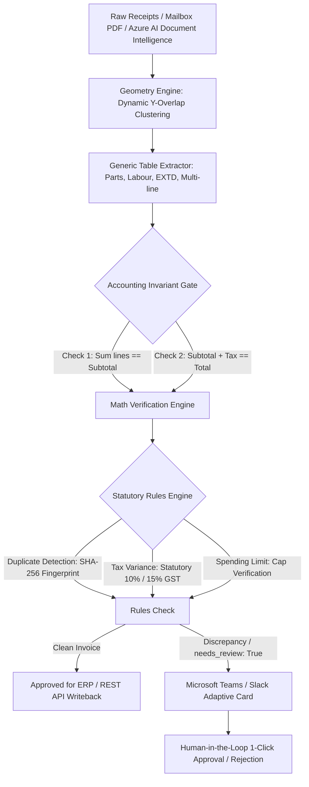

# Resilient Invoice Automation Engine (Deterministic Parser & Approval Pipeline)

[](https://www.python.org/)
[](LICENSE)
[]()
[]()

An enterprise-grade, fail-closed Accounts Payable (AP) and receipt processing pipeline. Combines **template-free geometric line-item extraction**, **strict mathematical cross-footing invariants**, and **statutory compliance rules (GST/VAT & duplicates)** with **Microsoft Teams Adaptive Card exception routing**.

Designed to process unseen receipt formats (maintenance orders, dealer service invoices, parts & labour sheets) with **zero LLM hallucinations** while orchestrating enterprise human-in-the-loop approvals.

---

## Architecture Overview



---

## Key Capabilities

### 1. Template-Free Geometric Line-Item Parser (Zero-LLM)
- **Dynamic Y-Overlap Clustering**: Groups OCR bounding boxes (`x0, y0, x1, y1`) into horizontal lines without rigid receipt coordinate templates.
- **Heterogeneous Layout Support**: Seamlessly parses side-by-side parts & labour columns, multi-line headers (`EXTD`, `EXT'D`, `TOTAL`), and job repair blocks (complaint / cause / correction).
- **Summary Strip Isolation**: Automatically excludes tax strips, balances due, and subtotals from being falsely extracted as charge lines.

### 2. Strict Mathematical Invariants (`needs_review: True`)
- **Zero Financial Leakage**: Every extracted receipt undergoes cross-footing checks:
  $$\sum \text{Line Items} = \text{Stated Subtotal}$$
  $$\text{Stated Subtotal} + \text{Stated Tax} = \text{Stated Total}$$
- If a single cent deviates beyond floating-point tolerance, `needs_review: True` is flagged instantly, preventing unverified transactions from entering the ledger.

### 3. Statutory Compliance & Duplicate Prevention
- **Invariant Hashing**: Deterministic composite fingerprinting (`SHA-256(Supplier + Invoice# + Amount + Date)`) blocks re-processing duplicate invoices from multiple mailboxes or retries.
- **GST / VAT Compliance**: Validates statutory tax rates (configurable for Australia 10% GST, New Zealand 15% GST, European VAT) and flags rate anomalies.
- **Spending Policy Gates**: Automatically halts invoices exceeding manager approval thresholds.

### 4. Human-in-the-Loop Microsoft Teams / Slack Integration
- Real-time JSON payload generator for **Microsoft Adaptive Cards 1.4**.
- Emits interactive cards with breakdown summaries and direct `Approve` / `Reject` action buttons for exception routing.

---

## Directory Structure

```text
├── src/
│   ├── parser/
│   │   ├── geometry.py             # WordBox clustering & line assembly
│   │   ├── table_extractor.py      # Template-free line item extraction
│   │   └── math_validator.py       # Deterministic cross-footing math check
│   ├── rules_engine/
│   │   ├── duplicate_detector.py   # Composite SHA-256 fingerprint ledger
│   │   └── tax_checker.py          # GST/VAT & spending limit validation
│   └── pipeline/
│       ├── intake.py               # End-to-end pipeline coordinator
│       └── approval_dispatcher.py  # MS Teams Adaptive Card dispatcher
├── tests/
│   ├── test_geometry.py            # Synthetic bounding box clustering tests
│   ├── test_math_validator.py      # Discrepancy & needs_review validation
│   ├── test_rules_engine.py        # Duplicate and tax compliance tests
│   └── test_pipeline.py            # End-to-end processing pipeline tests
├── CLAUDE.md                       # AI coding agent project rules (Claude Code / Codex)
├── AGENTS.md                       # Multi-agent parallel coordination specs
├── DEMO_SCRIPT.md                  # 2-minute video walkthrough script
└── requirements.txt
```

---

## Quickstart & Testing

### 1. Installation
Clone the repository and install dependencies:
```bash
git clone https://github.com/benjamindam-643/resilient-invoice-automation-engine.git
cd resilient-invoice-automation-engine
pip install -r requirements.txt
```

### 2. Run All Automated Tests
Execute the full synthetic test suite:
```bash
python -m unittest discover tests -v
```

Expected output:
```text
test_cluster_distinct_vertical_lines (tests.test_geometry.TestGeometryClustering) ... ok
test_cluster_words_same_horizontal_line (tests.test_geometry.TestGeometryClustering) ... ok
test_clean_math_passes_without_review (tests.test_math_validator.TestMathValidator) ... ok
test_line_item_sum_mismatch_triggers_needs_review (tests.test_math_validator.TestMathValidator) ... ok
test_total_mismatch_triggers_needs_review (tests.test_math_validator.TestMathValidator) ... ok
test_pipeline_clean_flow (tests.test_pipeline.TestPipelineCoordinator) ... ok
test_pipeline_flagged_flow_on_wrong_subtotal (tests.test_pipeline.TestPipelineCoordinator) ... ok
test_duplicate_fingerprint_detection (tests.test_rules_engine.TestRulesEngine) ... ok
test_over_limit_spending_threshold (tests.test_rules_engine.TestRulesEngine) ... ok
test_tax_rate_variance_rejection (tests.test_rules_engine.TestRulesEngine) ... ok

----------------------------------------------------------------------
Ran 10 tests in 0.003s

OK
```

---

## Production Showcase Disclosure
This repository contains a decoupled, generalized implementation derived from real-world enterprise invoice and receipt automation architectures. All proprietary vendor credentials, internal fleet schemas, and private database keys have been sanitized and replaced with synthetic fixtures.
